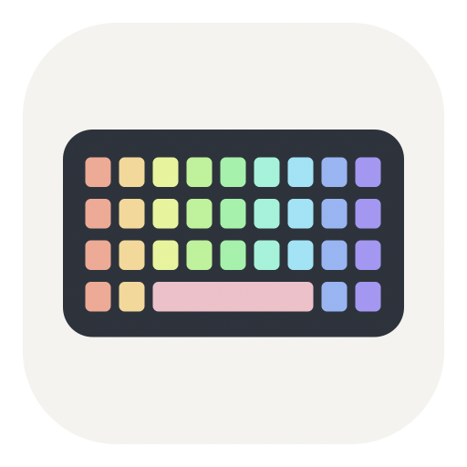

# 键盘灯控 · Keyboard Lights



**作者 / Author：[Wenshuishi0528](https://github.com/Wenshuishi0528)** · **v0.3.0** · **[CC BY-NC 4.0](LICENSE)**

为 **CHERRY MX 3.1 RGB（USB 046A:01D7）** 制作的 macOS 原生中文控制工具。在电脑上调整主键区灯效、亮度、速度和颜色，随机挑选新颜色，保存常用方案，并调整 Mac 常用按键。保留键盘板载灯效与三套配置，无需安装系统扩展。

A native macOS app for **CHERRY MX 3.1 RGB (USB 046A:01D7)**. Adjust main-key lighting, brightness, speed and color, pick a random color, save local profiles, and remap common Mac keys. It preserves the keyboard's onboard effects and three configuration slots and requires no system extension. The app interface is primarily Chinese.

**[下载 / Download the latest release](https://github.com/Wenshuishi0528/cherry-mx31-lighting-mac/releases/latest)** · [更新记录 / Changelog](CHANGELOG.md) · [验证范围 / Validation](docs/TESTING.md)

## 功能 / Features

| 功能 | Feature |
| --- | --- |
| 10 种内置主键区灯效选项、0–4 级亮度、5 档速度、RGB 选色 | Ten built-in main-key effect options, brightness, speed and RGB color |
| 独立的“单色 / 彩色”选项，可启用键盘内置彩虹波浪 | A separate Single color / Rainbow selector for built-in rainbow wave lighting |
| 随机选色，每次点击生成新的明亮颜色 | Random color button that generates a new bright color each click |
| 自动读取当前板载配置，修改后读回核对 | Detect the active onboard slot and verify configuration readback |
| 首次成功连接备份三套灯光，保留上次设置用于恢复 | Initial backup of all three lighting pages and undo for the last lighting change |
| 本机方案保存、载入、JSON 导入导出 | Local profiles with JSON import and export |
| 仅针对本键盘的 Win / Alt 交换、Caps Lock → Esc / Control | Device-scoped Win / Alt swapping and Caps Lock remapping via macOS |
| 侧栏与使用说明页显示版本和作者 | Visible app version and author credits |

## 安装与使用 / Install and use

1. 从 [Releases](https://github.com/Wenshuishi0528/cherry-mx31-lighting-mac/releases) 下载 `KeyboardLights-v0.3.0-macOS-arm64.zip`，解压后打开 `键盘灯控.app`。可将应用拖到“应用程序”文件夹。
2. 用 USB 连接键盘，等待读取完成，确认窗口显示的板载配置编号。
3. 如果 macOS 拒绝访问，在「系统设置 → 隐私与安全性 → 输入监控」允许本应用，再退出并重新打开。移动应用或安装新构建后可能需要重新授权。
4. 要同时显示多种颜色，选择「颜色模式 → 彩色 · 彩虹」，再点击「应用到键盘」。常亮模式会切换到彩虹波浪；内置光谱循环和滚动本身使用彩色。
5. 要使用一种颜色，选择「单色」，手动选色或点击「随机选色」，再点击「应用到键盘」。随机选色挑选的是一种单色；它不持续自动循环换色，也不会自动写入键盘。
6. 使用「恢复上次设置」恢复上一份灯光快照；如果切换过板载配置，先切回对应配置。

Download the Apple Silicon ZIP from [Releases](https://github.com/Wenshuishi0528/cherry-mx31-lighting-mac/releases), unzip it and open the app. Connect the keyboard over USB. If access is denied, enable the app in **System Settings → Privacy & Security → Input Monitoring**, then relaunch it. For multiple colors at once, select **彩色 · 彩虹 / Rainbow** and click **应用到键盘 / Apply**; Static switches to Rainbow Wave. For a single color, select **单色 / Single color**, choose a color or use **随机选色 / Random color**, then Apply. Random color edits the draft only and does not continuously cycle colors.

发布包采用 ad-hoc 签名，没有 Apple Developer ID 签名或公证。macOS 可能要求手动确认来源；不会自动降低系统安全设置。`SHA256SUMS.txt` 提供下载包校验值。

The release uses an ad-hoc signature and is not Developer ID signed or notarized. macOS may require manual approval. The app does not change system security settings. Verify the download with the supplied `SHA256SUMS.txt`.

```sh
shasum -a 256 -c SHA256SUMS.txt
```

## 兼容范围 / Compatibility

| 项目 / Item | 范围 / Scope |
| --- | --- |
| 系统 / OS | macOS 14+ |
| 处理器 / CPU | Apple Silicon / arm64 |
| 实测型号 / Tested device | CHERRY MX 3.1 RGB, VID 046A, PID 01D7 |
| 连接方式 / Connection | USB |
| 界面语言 / UI | 中文为主 / Primarily Chinese |

当前实现仅匹配上述 USB 标识，不声称兼容其他 CHERRY 键盘。主键区红色常亮已由实物观察确认；配置读写和恢复已验证。各动画的实际表现、断电保留仍需更多测试。侧边灯、逐键配色和硬件宏尚未开放。

Only the exact USB ID above is enabled. Main-key static red has been visually confirmed; configuration reads, writes and restoration have been checked. Individual animations and power-cycle persistence need further validation. Side lighting, per-key RGB and hardware macros are not implemented.

## 板载配置与本机数据 / Onboard settings and local data

- 启动、重新读取、随机选色、载入或删除本机方案，都不会自动写入键盘。
- 只有点击应用、关闭背光或恢复设置时才发送灯光修改；修改当前板载配置的灯光参数，保留其他字段。界面显示后若切换了板载配置，应用会停止并要求重新读取。
- 没有删除板载配置、恢复出厂或刷固件功能。删除「本机方案」只删除 Mac 文件。
- Win / Alt 与 Caps Lock 调整通过 macOS `hidutil` 完成，不重写键盘硬件映射或宏；重启或拔插后可能需要重新应用。
- 只处理厂商控制应答，不记录普通按键或媒体键。无账户、遥测、后台更新或配置上传。

Launching, reading, randomizing a draft, loading or deleting local profiles never automatically changes the keyboard. Explicit lighting actions update the active slot's lighting parameters while preserving other fields. There is no onboard-profile deletion, factory reset or firmware flashing. Key remapping operates in the macOS session rather than rewriting hardware mappings or macros. Ordinary key input is ignored; the app has no accounts, telemetry or configuration uploads.

本机数据 / Local storage: `~/Library/Application Support/KeyboardLights/`

| 文件 / File | 内容 / Contents |
| --- | --- |
| `profiles.json` | 本机灯光方案 / Local lighting profiles |
| `board-lighting-initial.json` | 首次成功连接的三套灯光页快照 / Initial three-slot lighting snapshot |
| `last-lighting-backup.json` | 最近一次灯光修改前的快照 / Snapshot before the last lighting change |

备份是灯光配置快照，不是固件镜像或宏备份。该目录不会包含在下载包或公共源码中。

Backups contain lighting configuration, not firmware or macros. The data directory is not distributed with the app or public source.

## 从源码构建 / Build from source

需要 macOS 和 Xcode Command Line Tools；运行时不依赖第三方包。

Requires macOS and Xcode Command Line Tools. No third-party runtime dependencies.

```sh
./scripts/test.sh
./scripts/build.sh
open dist/键盘灯控.app
```

只读诊断 / Read-only diagnostics:

```sh
dist/键盘灯控.app/Contents/MacOS/KeyboardLights --diagnose
```

打包需要 Python 3（仅用于开发打包，不是应用运行依赖）。/ Packaging uses Python 3; the application itself does not depend on Python.

```sh
./scripts/package.sh
```

`--verify-roundtrip` 是开发用实机测试，会暂时更改灯光并尝试恢复，不用于自动 CI，也不能代替实物颜色观察。普通构建和协议检查不会发送硬件配置修改。

The optional `--verify-roundtrip` developer command temporarily changes lighting and attempts restoration. It is excluded from CI and does not prove LED color visually. Building and running protocol checks does not write device settings.

## 许可与致谢 / License and credits

原创源代码、文档和图像按 [CC BY-NC 4.0](https://creativecommons.org/licenses/by-nc/4.0/) 发布：允许署名、非商业条件下的分享和修改，分享时需标明修改。完整条款见 [LICENSE](LICENSE)，署名与范围见 [COPYRIGHT](COPYRIGHT)。这是公开源码的非商业许可项目，没有额外的“仅限个人”限制。

Original code, documentation and artwork are released under [CC BY-NC 4.0](https://creativecommons.org/licenses/by-nc/4.0/): attribution and noncommercial sharing and adaptation, with changes identified when sharing. See [LICENSE](LICENSE) and [COPYRIGHT](COPYRIGHT). No extra personal-use-only restriction is added.

协议研究参考 [Alex Bongers](https://github.com/AlexBongers/cherry-mx-lighting-mac/blob/main/PROTOCOL.md) 和 [Sebastian Kraus](https://github.com/skraus-dev/cherryrgb-rs)。第三方内容保留原许可及完整署名，见 [THIRD_PARTY_NOTICES](Resources/THIRD_PARTY_NOTICES.txt)；本项目许可不收回这些许可独立授予的权利。

Protocol references by Alex Bongers and Sebastian Kraus retain their original MIT notices. Third-party rights remain governed by those licenses. This independent project is not affiliated with or endorsed by CHERRY.
